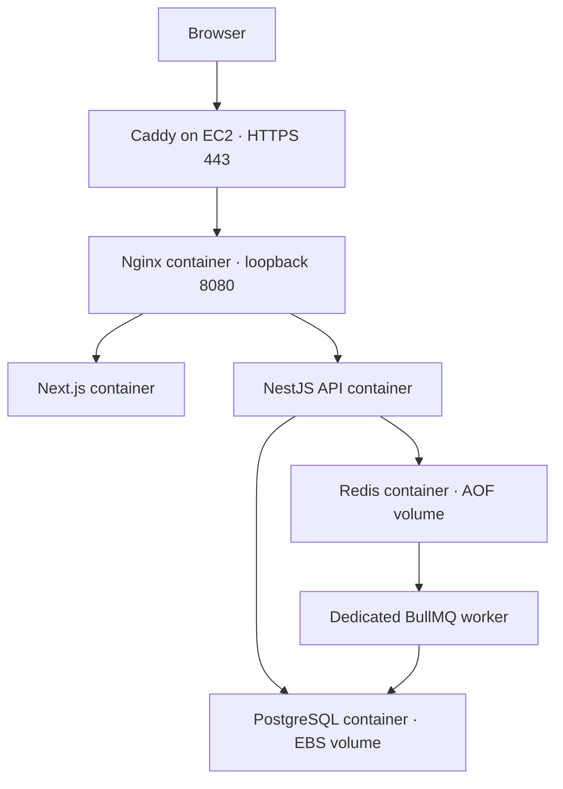
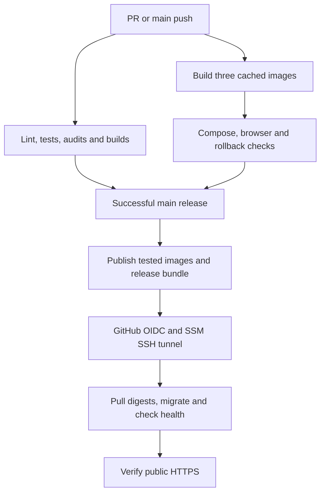

# TaskForge CloudOps

TaskForge CloudOps is a full-stack DevOps assessment project built on the open-source TaskForge application. It runs a Next.js frontend, NestJS API and dedicated BullMQ worker with PostgreSQL and Redis, using Docker Compose on an independently provisioned AWS EC2 instance.

[Live application](https://13.205.250.123/login) · [v2.0.0 release](https://github.com/yash-rai-93/taskforge-cloudops/releases/tag/v2.0.0) · [Verified automated deployment](https://github.com/yash-rai-93/taskforge-cloudops/actions/runs/42828875258)

## Release and verification status

Version `v2.0.0` points to `400c8effe8583956cc1ef4a23dc192f85bb6db2c`. On 10 November 2026, the main workflow built, tested, published and deployed this commit successfully on its first attempt. GitHub Actions verified the public HTTPS login page and API. Independent EC2 checks confirmed that the running frontend, API and worker digests matched the release manifest and that all six long-running containers were healthy.

Production SMTP is currently disabled. Sign-in requires a verified account, so assessment demonstrations use a privately provisioned demo account. Public registration, password-reset email and invitations require SMTP configuration before they can be used normally. Credentials and verification links are kept out of this repository.

## Project scope and attribution

The starter application comes from [engmaryamameen/TaskForge](https://github.com/engmaryamameen/TaskForge). Its project management interface, organizations, authentication, role-based access, tasks, notifications and billing architecture are inherited.

This fork adds independent environment configuration, dependency remediation, complete containerization, a user-visible project summary queue, GHCR release automation, Terraform infrastructure, EC2 bootstrapping, HTTPS deployment, health monitoring, backups and recovery verification. The upstream copyright and [MIT license](LICENSE) are retained.


## Architecture



The public proxy handles page requests, API routing and WebSockets on one origin. PostgreSQL and Redis use the internal Compose network. Only HTTP and HTTPS are admitted by the EC2 security group. Administration and deployment use AWS Systems Manager.

| Component | Implementation |
| --- | --- |
| Frontend | Next.js 15, React 19, TypeScript |
| API | NestJS 11, TypeORM, JWT authentication |
| Background processing | BullMQ with a separate worker process |
| Database | PostgreSQL 16 with a persistent Docker volume |
| Queue storage | Redis 7 with authentication, AOF and no eviction |
| Container runtime | Docker Engine and Docker Compose on Ubuntu EC2 |
| HTTPS | Host Caddy proxy with a trusted IP certificate |
| Infrastructure | Terraform, dedicated VPC, public subnet, encrypted EBS and Elastic IP |
| Delivery | GitHub Actions, GHCR, SHA tags and digest-pinned deployment bundles |

## Run locally

Install Git and Docker Engine with Compose v2.24 or later, or Docker Desktop with Compose.

```bash
git clone https://github.com/yash-rai-93/taskforge-cloudops.git
cd taskforge-cloudops
docker compose up -d --build --wait --wait-timeout 180
```

1. Open http://localhost:8080.
2. Register an account.
3. Open the local Mailpit inbox at http://localhost:8025 and follow the verification link.
4. Create a project and tasks, then use **Project summary → Generate summary**.

The local Compose stack supplies synthetic development credentials. Mailpit captures local email. Application images include their Node runtime, so host Node.js is optional for this path.

```bash
docker compose ps -a
docker compose logs --tail 80 api worker frontend nginx
docker compose down
```

Normal `docker compose down` retains the data volumes. Adding `-v` deletes the volumes and their data.

### Develop outside the application containers

Use Node.js 22 and separate terminals for the API, worker and frontend. Start supporting services from the repository root.

```bash
docker compose -f docker-compose.yml -f docker-compose.dev.yml up -d postgres redis mailpit
```

Configure the examples for the local ports, then start each process.

```bash
# API terminal
cd backend
cp .env.example .env
npm ci
npm run migration:run
npm run start:dev
```

```bash
# Separate worker terminal
cd backend
npm run start:worker:dev
```

```bash
# Frontend terminal
cd frontend
cp .env.local.example .env.local
npm ci
npm run dev
```

Open http://localhost:3001 for this development mode. Complete email verification through the local Mailpit inbox.

## Services and readiness

| Service | Build or image | Readiness and lifecycle |
| --- | --- | --- |
| frontend | `frontend/Dockerfile` | Next.js login-page health check |
| api | `backend/Dockerfile` | Health endpoint checks PostgreSQL and Redis |
| worker | `backend/Dockerfile.worker` | Heartbeat checks both queue consumers and dependencies |
| migrate | API image with migration command | One-shot migration before application startup |
| postgres | PostgreSQL 16 Alpine | Persistent volume and `pg_isready` |
| redis | Redis 7 Alpine | Authenticated PING and persistent AOF |
| nginx | Unprivileged Nginx image | Proxy health check after application readiness |
| mailpit | Local development only | Captures signup and other emails |

Production application containers use restart policies, non-root images, read-only filesystems, dropped capabilities and bounded logs. A health check marks an unhealthy container. A restart policy handles eligible process exits, so a running but unhealthy process still needs diagnosis.

## Environment configuration

| File | Purpose |
| --- | --- |
| `.env.example` | Optional local Compose overrides |
| `backend/.env.example` | API and worker host development |
| `frontend/.env.local.example` | Frontend host development |
| `.env.production.example` | Production configuration template |

| Variables | Purpose |
| --- | --- |
| `DB_NAME`, `DB_USERNAME`, `DB_PASSWORD` | PostgreSQL database and credentials |
| `DB_HOST`, `DB_PORT` | Production Compose fixes these to its internal database service |
| `REDIS_HOST`, `REDIS_PORT`, `REDIS_PASSWORD` | Queue connection and authentication |
| `JWT_SECRET` | Unique signing secret, at least 32 characters |
| `ACCESS_TOKEN_TTL`, `REFRESH_TOKEN_TTL` | Authentication token lifetimes |
| `FRONTEND_URL` | Public browser origin and email-link origin |
| `NEXT_PUBLIC_API_URL`, `NEXT_PUBLIC_SOCKET_URL` | Public frontend build-time origins |
| `IMAGE_NAMESPACE`, `API_IMAGE_TAG`, `WORKER_IMAGE_TAG`, `FRONTEND_IMAGE_TAG` | Image namespace and commit versions |
| `HTTP_PORT` | Production proxy binding, `127.0.0.1:8080` |
| `SMTP_ENABLED`, `SMTP_HOST`, `SMTP_PORT`, `SMTP_SECURE`, `SMTP_USER`, `SMTP_PASS`, `SMTP_FROM` | Optional transactional email delivery |
| `STRIPE_SECRET_KEY`, `STRIPE_WEBHOOK_SECRET`, `STRIPE_PRICE_ID_PRO`, `STRIPE_PRICE_ID_ENTERPRISE` | Optional billing integration |

Blank public API and socket origins select same-origin routing. Explicit values contain an origin without `/api/v1` or `/socket.io`. Next.js embeds public variables when the frontend is built, so changing them requires a rebuilt image.

Store production secrets in `/srv/taskforge/deploy/.env.production`, owned by `deploy` with mode `600`. Supply independently generated database, Redis and JWT secrets. The deployment bundle supplies the release image metadata. Keep real environment files, credentials and Terraform state out of Git.

## Demonstrate a real background job

Open a project and click **Generate summary**. The API checks authentication and organization/project access, then adds a `project-summary` job to the Redis-backed `project-reports` queue. The worker reads a PostgreSQL snapshot, aggregates task counts and updates progress at actual processing boundaries. The frontend polls the API for queue state and the returned summary.

| Method | Endpoint | Purpose |
| --- | --- | --- |
| POST | `/api/v1/projects/:projectId/reports` | Queue a summary and receive HTTP 202 with a job ID |
| GET | `/api/v1/projects/:projectId/reports/:id` | Read actual state, progress and result |
| GET | `/api/v1/health` | Check API dependencies |
| GET | `/health` | Proxy-accessible API health route |

Reports require a JWT and organization context through `x-organization-id`. Job access also checks the requesting user and project. Transient failures use three attempts with exponential backoff. Completed results are eligible for cleanup after 24 hours or beyond 1,000 retained jobs. Failed results have a seven-day retention policy.

For a local recovery demonstration, stop the worker, submit a report and observe **Queued**. Start the worker and watch the report complete.

```bash
docker compose stop worker
# Submit a report in the browser.
docker compose start worker
```

See [background job design and tests](docs/BACKGROUND_JOBS.md) for authorization, failure behavior and retention details.

## CI/CD and image releases



Pull requests validate changes. Successful pushes to `main` publish the tested image archives and deploy when `AWS_DEPLOY_ENABLED=true`. Buildx caches are separate for each image. Failed checks block publishing and deployment.

| Component | Image tag |
| --- | --- |
| Frontend | `ghcr.io/yash-rai-93/taskforge-cloudops-frontend:<commit-sha>` |
| API | `ghcr.io/yash-rai-93/taskforge-cloudops-api:<commit-sha>` |
| Worker | `ghcr.io/yash-rai-93/taskforge-cloudops-worker:<commit-sha>` |

Commit tags identify versions. Release manifests pin the images by SHA-256 digest, and the migration service uses the API digest. GitHub releases such as `v2.0.0` label a tested source commit. Production deployment uses that commit's image digests.

The `production` GitHub environment contains the deployment destination, region, role ARN and public origin. Its two secrets are `DEPLOY_SSH_KEY` and `DEPLOY_KNOWN_HOSTS`. GitHub OIDC obtains temporary AWS credentials, while the dedicated SSH key authenticates the deployment account inside the SSM tunnel. Verify the host public key independently before configuring it.

See [CI/CD configuration](docs/CI_CD.md) and [the production runbook](docs/PRODUCTION.md) for the complete variables and deployment procedure.

## Reproduce the AWS deployment

The Terraform baseline uses Ubuntu on a `t3.medium` in Mumbai, a dedicated VPC/subnet, an Elastic IP, a 12 GiB root disk and a 20 GiB data disk. Both disks are encrypted. Docker data lives under `/srv/taskforge/docker` on the data disk.

1. Review the [Terraform guide](infra/aws/README.md), configure the expected AWS account and inspect the plan and costs.
2. Provision the approved resources and confirm bootstrap, the data mount, Docker and Systems Manager readiness.
3. Configure the private production environment and HTTPS proxy.
4. Configure the GitHub production environment, its main-branch restriction and deployment credentials.
5. Enable `AWS_DEPLOY_ENABLED`, merge a reviewed change and inspect the production job.
6. Compare `current/release.json` with the running image digests and verify public HTTPS.

The current deployment uses a trusted Let's Encrypt IP certificate. Caddy forwards to the loopback Nginx port and manages certificate renewal. See the runbook for the IP certificate configuration and the alternative of using an owned DNS name.

Infrastructure creation incurs AWS charges. Review the documented baseline estimate and current account pricing before applying a new stack.

## Monitoring, backups and recovery

Five-minute systemd checks inspect all long-running containers, restart counts, the data mount, disk usage, backup freshness and HTTPS. Failures appear in the systemd journal. EC2 basic CloudWatch metrics provide CPU usage, CPU credits, network activity and instance status.

```bash
sudo systemctl list-timers 'taskforge-*'
sudo journalctl -u taskforge-check.service -u taskforge-backup.service --since today
docker ps -a
docker stats --no-stream
sudo journalctl -u caddy --since today
```

PostgreSQL dumps run daily at 02:15 UTC. Archives are validated and kept for about seven days in the root-only `/srv/taskforge/backups` directory. The restore drill loads an archive into a temporary network-isolated PostgreSQL container and checks the restored project table.

```bash
sudo /usr/local/lib/taskforge/production-ops.sh restore-check \
  /srv/taskforge/backups/taskforge-YYYYMMDDTHHMMSSZ.dump
```

Select an actual archive filename before running the command. Local backups share the data disk with production data. Off-host backups and paging alerts remain future work.

A deployment validates its bundle, takes a lock, pulls images, runs migrations and waits for health checks. Failed application rollout attempts restore the previous healthy release. Public probe failure also triggers a rollback attempt. For an intentional operator rollback during a controlled window:

```bash
sudo -u deploy python3 -B /srv/taskforge/deploy/current/scripts/deploy.py \
  --root /srv/taskforge/deploy \
  --repository yash-rai-93/taskforge-cloudops \
  --rollback
```

Application rollback retains data volumes and skips reverse migrations. Schema changes must remain compatible with the previous application, and a checked database backup is required before risky migrations.

## Validation and assessment evidence

| Requirement | Verified evidence |
| --- | --- |
| Containerization | Three images built in CI, complete Compose startup and service health checks |
| CI/CD | [Main run 42828875258](https://github.com/yash-rai-93/taskforge-cloudops/actions/runs/42828875258) passed checks, publishing and automatic EC2 deployment |
| AWS hosting | Public HTTPS verified by GitHub Actions, with matching running digests checked on EC2 |
| Background jobs | Authenticated production report stayed queued during worker interruption and completed after restart |
| Persistence and recovery | CI tested persistence and application rollback; a production PostgreSQL backup restored successfully in isolation |
| Infrastructure | [Terraform and bootstrap validation](https://github.com/yash-rai-93/taskforge-cloudops/actions/runs/42828875207) passed |
| Monitoring | Host check detected the stopped worker and returned to healthy after readiness recovered |

Run application checks locally after installing dependencies:

```bash
(cd backend && npm ci && npm run lint:check && npm test -- --runInBand && npm run build)
(cd frontend && npm ci && npm run type-check && npm run build)
```

Production authentication and reporting were exercised through the host HTTPS proxy. CI also exercised the browser interface in its disposable Compose stack. The public browser walkthrough remains a submission step. Production now retains a previous release, but a live production rollback has not been exercised.

The assessment walkthrough must show the actual screen and remain below 180 seconds. Target 165–170 seconds and show the architecture, Docker configuration, successful pipeline, live report result, and recovery approach. Keep credentials and private logs out of the recording.

## Documentation map

- [Container setup and networking](docs/CONTAINERS.md)
- [Background jobs](docs/BACKGROUND_JOBS.md)
- [CI/CD and GHCR](docs/CI_CD.md)
- [Production deployment and operations](docs/PRODUCTION.md)
- [Terraform and bootstrap](infra/aws/README.md)
- [Original configuration audit](docs/VEGAH_CONFIGURATION_AUDIT.md)

## Limitations

This is a single-instance deployment with brief interruptions possible during rollout. Production email delivery and paid billing are disabled. Local backups do not protect against losing the data disk, and monitoring currently has no external pager or log shipping. The verified production release is recorded above as dated evidence.

## License

Distributed under the [MIT license](LICENSE). Original TaskForge copyright belongs to engmaryamameen. This fork retains that attribution and documents the independent DevOps implementation.
