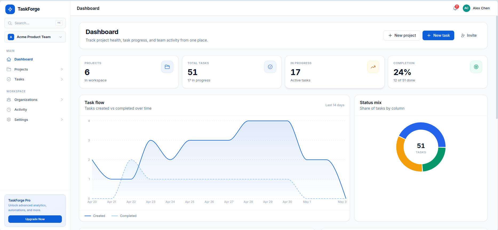
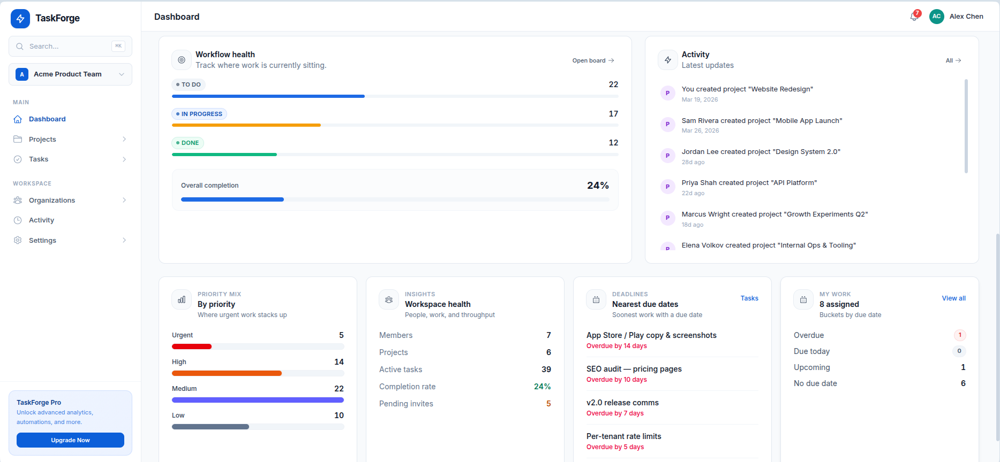
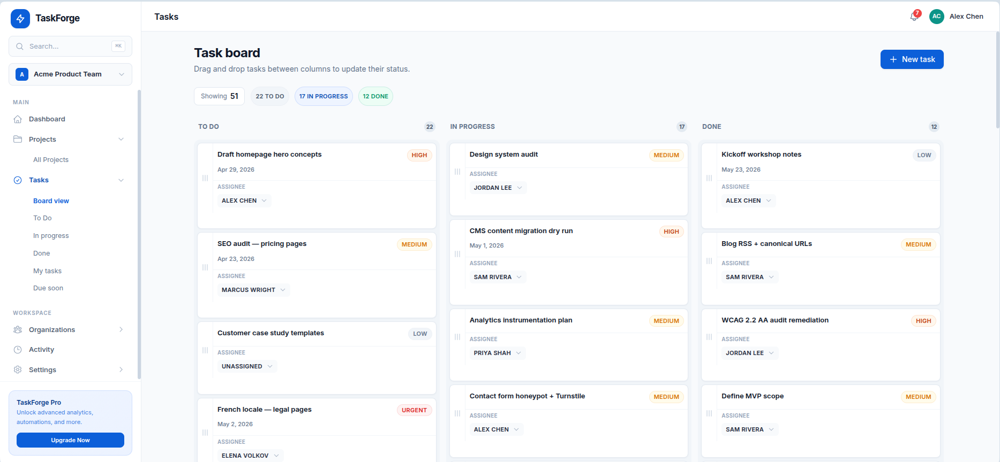
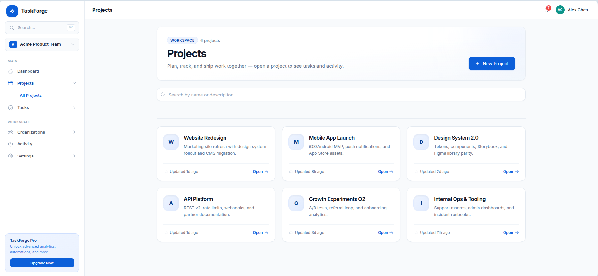

# TaskForge — Multi-Tenant SaaS Project Management Platform

TaskForge is an open-source SaaS project management starter built with **Next.js, NestJS, PostgreSQL, Redis, Socket.IO, Stripe, Docker, and CI/CD**.

It includes organization-based multi-tenancy, role-based access control, Kanban task management, real-time notifications, email workflows, billing architecture, and a polished dashboard UI.

## VEGAH assessment preparation

This repository is [yash-rai-93/taskforge-cloudops](https://github.com/yash-rai-93/taskforge-cloudops),
using [engmaryamameen/TaskForge](https://github.com/engmaryamameen/TaskForge) as its starter.
The application features and screenshots below are inherited. Our assessment work
adds independent configuration, dependency remediation and complete containerization.
An AWS deployment URL has not been verified.

**Run the entire application:** `docker compose up -d --build --wait --wait-timeout 180`

Open **http://localhost:8080** and use the local verification inbox at
**http://localhost:8025** after registration. No real email account is needed.

See [container operations and architecture](docs/CONTAINERS.md) for services,
production preparation, environment settings, host development and verification.
Open a project and use **Project summary** to see a Redis/BullMQ job's real status,
progress, retries and result. See [background jobs](docs/BACKGROUND_JOBS.md) for API,
retention, security and a short walkthrough sequence.

The [configuration audit](docs/VEGAH_CONFIGURATION_AUDIT.md) records the preceding
milestone. Three-image GHCR publishing, HTTPS and AWS deployment remain upcoming.

---

## Why This Project Stands Out

- **Multi-tenant SaaS architecture** — organization-scoped data isolation
- **Role-based access control** — Admin / Member with guard chain enforcement
- **Kanban board** with drag-and-drop tasks using dnd-kit
- **Real-time notifications** using Socket.IO
- **Email notifications** using Nodemailer
- **Stripe subscription billing** structure
- **JWT auth** with refresh token rotation and theft detection
- **PostgreSQL + Redis** backend architecture
- **Docker-based** local and production setup
- **CI/CD pipeline** with GitHub Actions

---

## Screenshots

### Dashboard & Analytics

**Overview** — Stats cards, task flow over time, and status mix.


**Operational view** — Workflow health, activity feed, priority mix, deadlines, and "My work."



### Kanban Board



### Projects

**Project grid** — Workspace projects with search and card layout.



**Project detail** — Single project header with board/ta…467 tokens truncated…*Backend** | NestJS 11, TypeScript |
| **Database** | PostgreSQL 16, TypeORM |
| **Cache** | Redis 7, ioredis |
| **Queue** | BullMQ (separate worker process) |
| **WebSocket** | Socket.IO via NestJS Gateway |
| **Email** | Nodemailer with SMTP |
| **Billing** | Stripe SDK v22 |
| **Auth** | JWT + Passport + argon2 |
| **Logging** | Pino (structured JSON) |

---

## Project Structure

```
TaskForge/
├── frontend/                    # Next.js 15 App Router
│   └── src/
│       ├── app/                 # Pages (auth, dashboard)
│       ├── components/          # UI components + layout
│       ├── features/            # Feature modules (tasks, projects, orgs)
│       ├── hooks/               # Shared hooks
│       ├── lib/                 # API client, utils, socket
│       ├── store/               # Zustand stores
│       └── types/               # TypeScript interfaces
│
├── backend/                     # NestJS 11 API
│   └── src/
│       ├── modules/
│       │   ├── auth/            # JWT, refresh tokens, login/register
│       │   ├── users/           # User management
│       │   ├── organizations/   # Multi-tenant orgs, memberships, invites
│       │   ├── projects/        # Project CRUD
│       │   ├── tasks/           # Task CRUD with assignment
│       │   ├── activity/        # Audit logging
│       │   ├── realtime/        # WebSocket gateway
│       │   ├── notifications/   # In-app notification system
│       │   ├── mail/            # Nodemailer email service
│       │   ├── billing/         # Stripe subscriptions
│       │   └── health/          # Health checks
│       ├── infrastructure/      # Database, Redis, Queue
│       ├── common/              # Guards, filters, decorators
│       └── shared/              # Enums, interfaces, errors│
```

---

## Getting Started

### Prerequisites
- Node.js 22+ (for host development; Docker includes Node)
- PostgreSQL 16+
- Redis 7+

### Backend Setup

For host-based development, start PostgreSQL and Redis using the local Compose file
from the repository root (`docker compose -f docker-compose.yml -f docker-compose.dev.yml up -d postgres redis mailpit`), or use your own local
services. The support-service ports bind to loopback only. Local passwords and JWT
examples are synthetic and must never be used for a public deployment.

```bash
cd backend
cp .env.example .env          # Edit with your credentials
npm ci
npm run migration:run         # Create database tables
npm run start:dev             # Start API on port 3000
npm run start:worker:dev      # Start background worker (separate terminal)
```

### Frontend Setup

```bash
cd frontend
cp .env.local.example .env.local
npm ci
npm run dev                   # Start on port 3001
```

### Access the App

1. Open `http://localhost:3001`
2. Register a new account
3. Create an organization
4. Start creating projects and tasks

---

## Environment Variables

- Backend host development: copy `backend/.env.example` to `backend/.env`.
- Frontend development: copy `frontend/.env.local.example` to `frontend/.env.local`.
- Future EC2 preparation: copy `.env.production.example` to `.env.production`, set
  file permissions to `600`, and fill the required blanks privately. Do not run the
  production stack until all three images are published and private configuration is ready.

NestJS expects the existing `DB_*`, `REDIS_*`, `JWT_SECRET`, `FRONTEND_URL`, and optional
integration keys. Production Compose requires database/Redis passwords and a JWT secret;
it provides no default production credentials or `latest` image tag.
`NEXT_PUBLIC_API_URL` and `NEXT_PUBLIC_SOCKET_URL` are public **build-time** origins;
changing a running container's environment does not change the browser bundle.
Neither origin should include `/api/v1` or `/socket.io`. Empty values currently use
the browser origin through Nginx. See the container guide for the full contract.

Stripe can be left blank to disable paid billing. Local Compose uses Mailpit for signup verification. Production
signup requires configured email delivery; no Mailpit inbox is included there. Do not use or publish verification/reset links from preview logs.

---

## Email Notification Setup

### Using Nodemailer with SMTP

TaskForge uses Nodemailer for transactional emails. Configure SMTP credentials in your backend `.env`:

```bash
SMTP_HOST=smtp.gmail.com      # Or any SMTP provider
SMTP_PORT=587
SMTP_SECURE=false
SMTP_USER=your-email@gmail.com
SMTP_PASS=your-app-password
SMTP_FROM=TaskForge <noreply@example.com>
```

### Testing with Mailtrap/Ethereal

For development, use [Mailtrap](https://mailtrap.io) or [Ethereal](https://ethereal.email):

```bash
SMTP_HOST=sandbox.smtp.mailtrap.io
SMTP_PORT=2525
SMTP_USER=your-mailtrap-user
SMTP_PASS=your-mailtrap-pass
```

### Email Events

| Event | Email Sent To | Content |
|-------|--------------|---------|
| Admin invites a user | Invited email address | Invitation with accept link |
| Task assigned to user | Assigned user's email | Task title, description, priority, due date |
| Task reassigned | Newly assigned user | Same as above |

When SMTP is not configured, emails are logged to console for development visibility.

---

## WebSocket Notifications

TaskForge uses Socket.IO for real-time notifications:

1. **Connection**: Client connects with JWT token in handshake auth
2. **Rooms**: Users join `user:{id}` (personal) and `org:{orgId}` (team) rooms
3. **Events**: Domain events (task.created, task.updated, member.joined) broadcast to org rooms
4. **Notifications**: Task assignments and member joins create persistent notifications
5. **Frontend**: Bell icon with unread count, dropdown with notification list

---

## API Endpoints

### Authentication
| Method | Path | Description |
|--------|------|-------------|
| POST | `/api/v1/auth/register` | Register new user |
| POST | `/api/v1/auth/login` | Login |
| POST | `/api/v1/auth/refresh` | Refresh tokens |
| GET | `/api/v1/auth/me` | Get current user |
| POST | `/api/v1/auth/logout` | Logout |

### Organizations
| Method | Path | Description |
|--------|------|-------------|
| POST | `/api/v1/organizations` | Create organization |
| GET | `/api/v1/organizations` | List user's orgs |
| POST | `/api/v1/organizations/switch` | Switch active org |
| GET | `/api/v1/organizations/current` | Get current org |
| GET | `/api/v1/organizations/members` | List org members |
| POST | `/api/v1/organizations/invites` | Create invite (admin) |

### Projects & Tasks
| Method | Path | Description |
|--------|------|-------------|
| POST | `/api/v1/projects` | Create project |
| GET | `/api/v1/projects` | List projects |
| POST | `/api/v1/projects/{id}/tasks` | Create task |
| GET | `/api/v1/tasks` | List all tasks |
| PATCH | `/api/v1/tasks/{id}` | Update task |

### Notifications
| Method | Path | Description |
|--------|------|-------------|
| GET | `/api/v1/notifications` | List notifications |
| GET | `/api/v1/notifications/unread-count` | Get unread count |
| POST | `/api/v1/notifications/{id}/read` | Mark as read |
| POST | `/api/v1/notifications/read-all` | Mark all as read |

---

## Architecture Highlights

### Request Flow
```
Client -> Next.js -> NestJS API
                        |
                   Guard Chain:
                   Throttler -> JWT -> OrgMembership -> Roles
                        |
                   Service Layer -> PostgreSQL
                        |
                   Domain Event Bus
                    /          \
              BullMQ         Socket.IO
              Queue          Broadcast
                |
              Worker
           (audit log)
```

### Multi-Tenant Isolation
- Organization ID validated at guard layer, not query layer
- Services read org context from validated request, never from user input
- Membership checked with 3-tier cache for performance

### Event-Driven Architecture
- All mutations emit domain events
- Events consumed by: Activity Logger, WebSocket Broadcaster, Notification Creator, Email Sender
- Background worker processes audit log asynchronously

---

## Contributing

Use a feature branch and a focused pull request for configuration changes. Do not commit live environment files or credentials.

See the [open issues](https://github.com/yash-rai-93/taskforge-cloudops/issues) for a list of known issues and planned features.

---

## License

[MIT](LICENSE), Copyright (c) 2026 engmaryamameen. Original starter attribution and
permission notice are retained; assessment-specific changes are documented separately.
