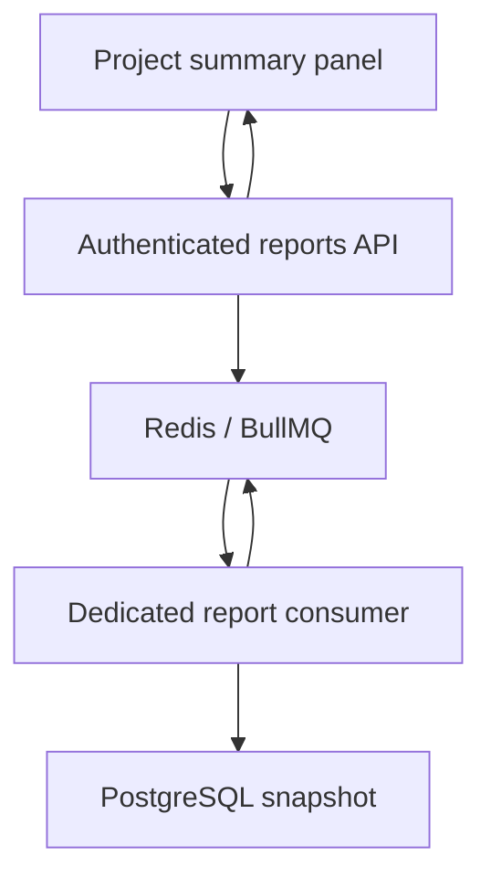

# Project summary jobs

The existing activity worker remains functional. The project page now also offers
**Project summary**, an explicit background request with visible queued, processing,
retrying, completed and failed states. It reuses Redis, BullMQ, PostgreSQL and the
existing dedicated worker container. No new service, dependency or migration is needed.

## Try it

```bash
docker compose up -d --build --wait --wait-timeout 180
```

Open http://localhost:8080, sign in, open a project and click **Generate summary**.
For local signup verification, use the captured inbox at http://localhost:8025.
The result shows task totals, counts by status/priority and task completion percentage.
Soft-deleted tasks are excluded. It is a snapshot when the worker runs; use
**Generate again** after editing tasks. An empty project returns zero counts.

To demonstrate actual queueing, stop the worker with `docker compose stop worker`,
submit a summary and observe **Queued**. Refreshing the page preserves the selected
job for the current tab/user/organization/project. Run `docker compose start worker`
and observe the real result. Normal reports may complete too quickly to see every
intermediate progress update; no artificial delays are added.

This makes a compact 20–30 second segment within the assessment's strictly
under-180-second screen recording. Start already signed in; never film auth tokens,
private environment files or email verification/reset links.

## Request and result flow



1. The API checks project membership/ownership scope using the existing guards and
   project service, then adds a `project-summary` job to `project-reports`.
2. The worker container's report consumer independently reads a PostgreSQL
   REPEATABLE READ snapshot. SQL aggregation groups active tasks by status and
   priority; it does not load an unbounded task list or use an external service.
3. The worker updates BullMQ progress at actual work boundaries: 10 (started),
   40 (project loaded), 80 (aggregation read), 100 (result ready).
4. BullMQ stores completion and the returned summary in Redis. The API reads this
   real state/result; the panel polls every two seconds while work is pending.
   It stops polling after completion/failure or a missing result.

The original `activity` consumer still owns audit persistence. Worker health now
requires **both** consumers running plus Redis PING and PostgreSQL SELECT 1.
Neither consumer is registered in the API application's provider graph. Queue
clients and consumers close before the shared Redis connection during shutdown.

## API

Both routes require a valid JWT, organization membership and UUID path parameters.
The existing `x-organization-id` header resolves organization context.

| Endpoint | Meaning |
| --- | --- |
| `POST /api/v1/projects/:projectId/reports` | Returns HTTP 202 with `id`, `projectId`, `statusUrl` after enqueueing |
| `GET /api/v1/projects/:projectId/reports/:id` | Returns real state, progress, attempts, timestamps, result or safe error |

The POST response deliberately does not invent an initial state: a fast worker
may finish before the first status request. GET states are derived from BullMQ:
waiting/paused -> queued, active -> processing, delayed (backoff) or waiting after
a failed attempt -> retrying, completed/failed -> the corresponding terminal state.
A transient inability to read Redis is an unavailable status response, not a fake
job failure. A deleted/missing/unauthorized job returns 404 without disclosing
whether another user owns that ID.

Access requires the queued **requester ID, organization ID and project ID** to match
the authenticated request. The browser scopes its cached job ID by all three IDs;
that ID confers no authorization. The API does not return raw job payloads,
connection information, stack traces or database failure reasons.

The requester can still inspect a retained failure if the project is subsequently
deleted. Other users cannot read it, even if they belong to the same organization.
A submission for a deleted or another organization's project is rejected before
any job is queued.

## Failure, recovery and retention

Transient processing errors use three attempts with exponential backoff starting
at two seconds. Progress during retrying reflects the last actual attempt. A removed
project uses BullMQ's permanent-error classification and fails without spending
further attempts. Worker logs include job ID/attempt and safe messages; raw SQL
errors are replaced before BullMQ persists them.

After terminal failure the panel offers **Try again**, which creates a new job;
the failed job remains available for inspection. Completed results are eligible
for lazy cleanup after 24 hours or beyond 1000 completed jobs; failed jobs after
seven days or beyond 1000 failures. BullMQ performs age/count cleanup as jobs finish,
so age cleanup is not an exact wall-clock TTL. Missing results show an unavailable/
expired message with an option to generate a new summary.

Redis AOF/named storage retains waiting jobs and results across ordinary container
recreation; stopping the worker does not remove pending jobs. Redis still uses
`noeviction` and every-second AOF fsync. This is not a backup or a guarantee against
host/disk loss. An in-flight submission whose HTTP connection fails may require
checking/retrying; no distributed transactional outbox or submission idempotency
contract is claimed. Report generation is read-only, so reprocessing has no business
mutation to duplicate. Its final snapshot can change if tasks change before a retry.

A 15-second PostgreSQL statement timeout bounds lock waits/slow queries per attempt.
The consumer concurrency is two. No progress is estimated from elapsed time and
there is no public forced-failure or artificial-delay input.

## Verification

```bash
(cd backend && npm test -- --runInBand && npm run lint:check && npm run build)
(cd frontend && npm run type-check && npm run build)
```

Backend tests cover authorization, bounded retry/retention policy, real-state
mapping, completion/result races, missing results, sanitized failures and permanent
versus transient worker errors. The previous pass-with-no-tests option is removed.

The existing Container integration workflow also executes
`scripts/report-jobs-browser.cjs` against the actual Compose stack and Chromium.
The PR's check results are authoritative for whether runtime assertions passed:

- Submit from the UI while the worker is stopped; inspect the same BullMQ job's
  waiting state, refresh the page and retain the queued job.
- Hold a real task-table SQL lock briefly to observe actual active state and 40%
  progress, release it and verify completed API/UI counts exclude deleted tasks.
- Queue work for a subsequently removed project and observe its permanent failure.
- Temporarily rename the tasks table only in the disposable CI database; verify
  actual worker exceptions, automatic retries, sanitized terminal failure and
  successful user retry after restoring the table.
- Verify unauthenticated/cross-organization/cross-project access is rejected;
  unit tests additionally cover a different requester in the same organization.
- Remove a retained BullMQ job to verify actual 404/expired-result UI recovery,
  and generate an empty-project report.

These fault controls are CI-only test code guarded by an explicit opt-in and a
`taskforge-ci-*` Compose project name. Do not run them against existing data.
They do not alter application worker behavior or simulate status API responses.
The existing persistence/crash-recovery and standalone production Compose checks
remain in place. No AWS provisioning or registry publishing is part of this phase.
