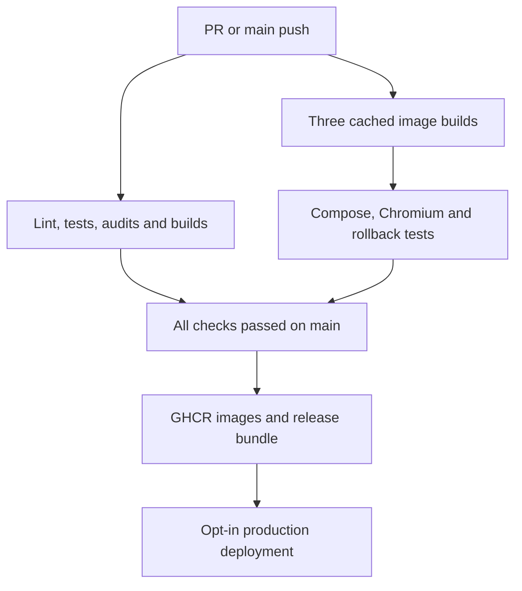

# CI, GHCR releases and EC2 deployment

The workflow runs for pull requests to `main` and pushes to `main`. Each push is
identified by its full commit SHA. Pull requests receive read-only validation.
Only a successful main push receives package write permission.



## Validation and release

`.github/workflows/ci.yml` installs the locked backend and frontend dependencies
on Node 22. Backend validation includes ESLint, Jest, compiled API/worker and
migration checks, and optional integration configuration checks. Frontend
validation includes ESLint, TypeScript and the standalone Next.js build. Both
npm audit jobs fail on high or critical advisories. Lower-severity findings
remain visible. The automation job checks workflow syntax and tests release
validation, deployment locking, and rollback decisions.

The reusable `containers.yml` builds `linux/amd64` API, worker and frontend images
with separate Buildx cache scopes. All three image archives are passed within the
same run to Docker Compose tests, including Chromium and the real Redis job flow.
The disposable deployment test uses a local registry, digest-pinned pulls, a
broken worker and a PostgreSQL persistence probe. The production target is x86-64.
Choose an x86-64 EC2 instance or add and test an ARM image build before using Graviton.

After all validation jobs pass on `main`, the publish job loads the same image
archives. It checks their repository and revision labels before any push. It logs
in with the job's short-lived `GITHUB_TOKEN` and publishes these tags:

| Component | GHCR tag |
| --- | --- |
| API and migration | `ghcr.io/yash-rai-93/taskforge-cloudops-api:<full-commit-sha>` |
| Worker | `ghcr.io/yash-rai-93/taskforge-cloudops-worker:<full-commit-sha>` |
| Frontend | `ghcr.io/yash-rai-93/taskforge-cloudops-frontend:<full-commit-sha>` |

The namespace is derived from the GitHub repository. Commit tags are write-once
by pipeline policy. A rerun reuses a matching existing image and fails if an
existing commit tag points to different contents. Deployment uses the resolved
`@sha256:` references. The migration service uses the API image digest. Only a
complete set of three verified digests produces a deployable artifact. A failed
push can leave individual tags in GHCR. It cannot advance the deployment.

Find `taskforge-release-<commit>` in the successful main run's artifacts. It
contains a checksummed archive with `release.json`, production Compose, the
pinned image override, Nginx configuration and deployment scripts. Keep the
bundle and its GHCR digests for any release you intend to restore. Tested image
archives expire after one day and release bundles after 30 days. Retry a failed
publish job while its tested images are available. A new commit gives a new
release if a rebuild would change the contents of an existing tag.

## GitHub setup

Publishing needs Actions enabled and permission for the repository's
`GITHUB_TOKEN` to write its GHCR packages. If an existing package has separate
access controls, grant this repository write access under its package settings.
Package visibility is separate from repository visibility. For the public
assessment, you can make the three packages public to simplify EC2 pulls. If they
stay private, configure the deploy account's Docker credential store on EC2 with
an authorized read-only package credential. Keep that credential on the host.

Use branch protection to require successful backend, frontend, automation, and
full-stack Compose checks before merging. The workflow already gates release jobs
on those validations after a main push. Third-party actions are pinned by commit
and Dependabot proposes GitHub Actions updates.

Create a `production` Actions environment restricted to `main`. Configure the
following once the host has been approved and prepared:

| Setting | Scope | Purpose |
| --- | --- | --- |
| `AWS_DEPLOY_ENABLED` | Repository variable | Set to `true` only when the environment and host are ready |
| `DEPLOY_HOST` | Environment variable | EC2 DNS name or IPv4 address |
| `DEPLOY_USER` | Environment variable | Dedicated SSH deployment account |
| `DEPLOY_ROOT` | Environment variable | Private host directory such as `/opt/taskforge` |
| `PRODUCTION_URL` | Environment variable | Public HTTPS origin, without a path or trailing slash |
| `DEPLOY_SSH_KEY` | Environment secret | Private key for the dedicated deployment account |
| `DEPLOY_KNOWN_HOSTS` | Environment secret | Verified OpenSSH host key for the configured host |

Leave the repository switch unset during setup. It is evaluated before the job
enters the environment. If reviewers are configured for `production`, GitHub will
hold deployments for review. Set the environment protection appropriate to the
assessment's required automatic delivery.

## EC2 prerequisites and recovery

The [Terraform and bootstrap guide](../infra/aws/README.md) covers host setup,
validation, cost and the approval step. Use its persistent deploy root
`/srv/taskforge/deploy` for that host.

Use an approved x86-64 Ubuntu 24.04 EC2 host with Docker Engine, the Compose plugin,
Python 3.12 and OpenSSH. Provide a controlled SSH route from the deployment runner
and verify the host key independently before setting `DEPLOY_KNOWN_HOSTS`. The
SSH account needs Docker access and ownership of the deployment directory.
Docker access grants broad host privileges, so use a dedicated host and account.

Place a mode-600 `.env.production` in `DEPLOY_ROOT` using the example as a template.
Supply the runtime database, Redis, JWT, public origin and email settings. The
release manifest supplies the image settings. Configure DNS, TLS termination,
private database/Redis networking and persistent storage before enabling delivery.
A TLS proxy can forward to the Compose HTTP port, which should be restricted to
that proxy. Confirm production signup can send email before recording the demo.

The workflow verifies the archive checksum on both sides of SSH. The host
validates the manifest and exact Compose image references, takes a deployment
lock, pulls the images, waits for PostgreSQL and Redis, and runs migrations.
Compose waits for API, worker, frontend and Nginx health. The host probes API
health and the login page through the proxy before advancing `current`. The runner
also checks public HTTPS health. A failed application rollout or public probe
attempts to restore the previous healthy release and leaves the workflow failed.
The first deployment has no previous release to restore.

The host keeps `releases/<commit>`, `current`, and `previous`. An operator can
restore the previous application bundle from the host:

```bash
python3 -B /opt/taskforge/current/scripts/deploy.py \
  --root /opt/taskforge --repository yash-rai-93/taskforge-cloudops --rollback
```

Keep prior bundles and images available. Rollback restores application images and
configuration. It preserves database and Redis volumes and skips migrations.
Use backward-compatible migrations and take verified PostgreSQL backups before
schema changes. An incompatible schema needs a separate recovery decision. A
single EC2 instance may briefly interrupt traffic while containers are replaced.

The PR runs local registry and Docker tests. First verify the three actual GHCR
packages and the release bundle after merging. Provisioning, the production SSH
route, HTTPS and live EC2 rollout require the AWS phase.
