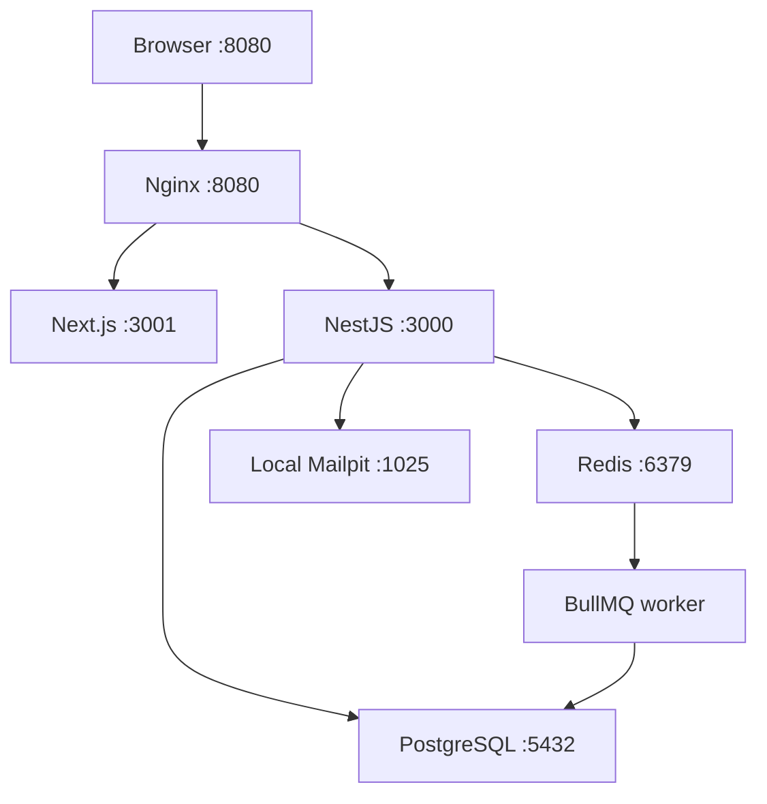

# TaskForge container operations

TaskForge's original Next.js/NestJS application and MIT attribution are retained.
The container milestone adds complete Compose orchestration and makes the existing
activity feed a real asynchronous worker result. [Project summary jobs](BACKGROUND_JOBS.md)
also expose explicit job status, progress, retry/failure and summary results. No cloud infrastructure is provisioned.

## Start the whole local application

Install Docker Engine with Compose v2.24+ (Docker Desktop includes Compose).
From a fresh checkout, run:

```bash
docker compose up -d --build --wait --wait-timeout 180
```

Open **http://localhost:8080**. Register an account, open the local captured email
at **http://localhost:8025**, and follow its verification link. Create a project
and task. The Activity page displays the worker's persisted result and polls every
five seconds. Nothing is sent to a real mailbox. No demo account or separate Node
process is required. Initial image compilation can take several minutes.

The default stack uses synthetic local credentials and binds its two published
ports to loopback. Do not use this development stack for public deployment.
`.env.example` documents optional overrides; copying it to `.env` is optional.
If APP_PORT changes, set FRONTEND_URL to the same browser origin (including port).

```bash
docker compose ps -a
docker compose logs --tail 80 api worker migrate frontend nginx
docker compose down                 # retains PostgreSQL and Redis data
# DESTRUCTIVE: only when you deliberately want to erase this local installation:
docker compose down -v
```

## Architecture and images



Nginx sends `/api/*`, `/socket.io/*` and `/health` to the API; other paths go to
Next.js, including static assets. Browser API and socket origins default to the
same origin, so a browser never tries to reach container DNS names or its own
localhost:3000. API CORS is constrained to FRONTEND_URL; WebSocket origins are
checked against that origin. The public proxy has no direct database access.

| Service | Image/build | Networks and readiness |
| --- | --- | --- |
| frontend | `frontend/Dockerfile` -> `taskforge-local-frontend` | edge; Node HTTP check on `/login` |
| api | `backend/Dockerfile` -> `taskforge-local-api` | edge + internal data; checks PostgreSQL/Redis through `/api/v1/health` |
| worker | `backend/Dockerfile.worker` -> `taskforge-local-worker` | internal data; fresh heartbeat requires both running BullMQ consumers, Redis PING and SQL SELECT 1 |
| migrate | Reuses API image, overrides command | internal data; one-shot TypeORM migrations must exit 0 before API/worker start |
| postgres | `postgres:16-alpine` | internal data; pg_isready, persistent pgdata volume |
| redis | `redis:7-alpine` | internal data; authenticated PING, persistent redisdata volume |
| nginx | `nginxinc/nginx-unprivileged:1.28-alpine` | edge; starts after healthy frontend/API/worker; proxy health check |
| mailpit | `axllent/mailpit:v1.33.1`, local only | edge; SMTP capture, readiness probe, loopback UI :8025 |

Three independent application Dockerfiles use Node 22 on Debian slim. API/worker
build stages are identical so BuildKit can reuse layers; each has its own final
image/command/health check. Dependency installation uses lockfiles and build-cache
mounts. Runtime backend dependencies omit dev packages. Frontend uses Next.js
standalone output instead of shipping the source/build tooling. No `.env` files
or keys enter application build contexts. Npm audit gates remain enabled in CI.

Application/proxy containers run without root, drop Linux capabilities, forbid
privilege escalation, use a read-only root filesystem and receive bounded tmpfs
scratch space. Next.js has a writable cache tmpfs. Long-lived services use
`unless-stopped`; the migration service does not restart. Application/proxy JSON
logs rotate at 10 MB x 3 files. Health checks report unhealthy processes; Docker
does **not** restart a still-running process merely because it is unhealthy.
An exited process is restarted, and dependency clients reconnect. Operator or
future monitoring action is needed for a permanently stuck unhealthy process.

## Worker, readiness and persistence decisions

Previously the activity listener wrote directly to PostgreSQL, leaving the queue
consumer unused for normal tasks. It now enqueues domain events on `activity`.
The dedicated worker persists the result; the existing organization-scoped
`GET /api/v1/activity` API and Activity UI expose that result. There is no fake
progress timer. This is an existing feature adapted for real queue processing,
not a new dashboard or generic job-management product.

Events get a UUID used as both BullMQ job ID and activity primary key. PostgreSQL
upsert makes replay of the same event idempotent. BullMQ retries failed jobs three
times with exponential backoff. Completed jobs are bounded to one hour/1000 jobs;
failed jobs to seven days/1000 jobs. Activity results remain in PostgreSQL even
when queue history is removed. The unused notifications queue is not claimed as
a functioning billing notification processor.

Redis AOF uses every-second fsync and `noeviction`. This protects queued jobs
across ordinary container recreation; a sudden host/disk failure can still lose
roughly a second of writes. PostgreSQL and Redis each have named volumes. Local
and production Compose use different project names to avoid accidental volume
sharing; override `-p` for separate installations. Volumes are not backups.
No automatic database restore, point-in-time recovery or cross-host persistence
is claimed in this milestone.

The worker loads complete TypeORM relation metadata even though it imports fewer
business modules than the API. It writes a dependency heartbeat into `/tmp` only
while both activity/report consumers and both dependencies are healthy. Queue clients and the
consumer close before the shared Redis connection quits. A 30-second termination
grace period allows ordinary jobs to finish before SIGKILL.

Domain events still originate from the inherited in-process event emitter after
writes. This is not a transactional outbox: a crash between DB commit and queue
submission can lose an event. Upsert handles replay, not that delivery gap. Keep
this limitation explicit before using the design for critical business auditing.

## Environment configuration

| Key | Local Docker | Production |
| --- | --- | --- |
| NODE_ENV / PORT | fixed production / API 3000 in containers | same |
| DB_HOST / DB_PORT | postgres / 5432 | same, private |
| DB_NAME / DB_USERNAME / DB_PASSWORD | synthetic local defaults, overridable | required, no password default |
| REDIS_HOST / REDIS_PORT / REDIS_PASSWORD | redis / 6379 / synthetic local password | required private password shared by Redis/API/worker |
| DB_SSL / REDIS_TLS | false on the isolated data network | same; changing to external TLS services needs deliberate configuration |
| JWT_SECRET | synthetic local-only default | required unique value >=32 characters |
| FRONTEND_URL | http://localhost:8080 | required actual browser origin for links/CORS |
| NEXT_PUBLIC_API_URL / NEXT_PUBLIC_SOCKET_URL | blank build args: same origin | recommended blank when publishing frontend; explicit public origins require a rebuild |
| SMTP_ENABLED | true, local Mailpit, no auth | false by default; set true and configure a real provider for public signup |
| SMTP_HOST / PORT / USER / PASS / SECURE / FROM | Mailpit:1025, empty credentials, no external delivery | optional provider settings; credentials private; true/false flags |
| IMAGE_NAMESPACE | local image names used automatically | required GHCR owner/repository prefix |
| API_IMAGE_TAG / WORKER_IMAGE_TAG / FRONTEND_IMAGE_TAG | local builds | required published full commit-SHA tags |
| APP_PORT / MAILPIT_PORT | optional host ports, defaults 8080/8025 | HTTP_PORT controls the production proxy port |

SMTP_ENABLED is a new explicit delivery override, allowing unauthenticated local
SMTP. If it is absent in host-based configuration, the prior behavior (enable
with both SMTP_USER and SMTP_PASS) remains. False explicitly disables delivery.
Production does not contain Mailpit. Without configured mail delivery, the API
can start, but a new public signup cannot complete email verification. Never
publish verification/reset links from logs or inbox content. API logs redact
authorization/cookie headers and Nginx omits query strings from access logs.

## Keep host-based development usable

For Node 22 development outside containers, expose only the support services:

```bash
docker compose -f docker-compose.yml -f docker-compose.dev.yml up -d postgres redis mailpit
# In separate terminals, use the existing scripts:
(cd backend && cp .env.example .env && npm ci && npm run migration:run && npm run start:dev)
(cd backend && npm run start:worker:dev)
(cd frontend && cp .env.local.example .env.local && npm ci && npm run dev)
```

The overrides publish DB/Redis/SMTP on loopback only. Backend host examples use
that Redis password and localhost:1025 mail capture; frontend examples explicitly
use localhost:3000 and localhost:3001. Do not overlay docker-compose.dev.yml on
the production file, and do not run host Node services and a conflicting full
containerized stack at the same time.

## Production preparation

Use the production Compose file and image override from a release bundle. The
[CI/CD guide](CI_CD.md) explains GHCR package access, host setup, and the deployment
command. Keep `.env.production` private and fill the settings from the example.
The bundle pins API, worker, frontend and migration to the tested image digests.

Production has the full frontend/proxy/API/worker/migration/database/Redis
topology, private DB/Redis networking and no development ports or inbox. Only
Nginx's configured HTTP port is published. HTTPS termination, approved EC2
resources, ingress controls, backups and monitoring require host setup. Do not expose this HTTP preparation
publicly with real credentials before HTTPS and AWS access controls are ready.
Database passwords in an env file are visible to host/Docker administrators;
file permissions and a trusted host are required. The initial PostgreSQL role
created by the official image is privileged; separate migration/application roles
are an additional hardening task before wider production use.

## Verification and troubleshooting

The reusable `.github/workflows/containers.yml` runs on GitHub-hosted Docker
runners. It builds the three images once and tests those image archives before
`ci.yml` can publish them on a main push. See the PR checks for runtime results.

The workflow builds all three images and exercises:

- health/readiness, non-root processes, unauthenticated Redis rejection;
- real signup/email capture/verification with synthetic credentials;
- task creation, actual BullMQ completion and worker-only activity persistence;
- stopped-worker queue accumulation followed by PostgreSQL/Redis recreation;
- surviving tasks and pending jobs, replay idempotence, crash restart and worker health;
- Chromium login, actual UI task submission, Socket.IO WebSocket upgrade and the
  displayed asynchronous result, with all browser requests using the proxy origin;
- the standalone production topology with locally tagged SHA images, newly
  generated secrets, fresh migrations, no inbox and no published DB/Redis ports;
- digest-pinned deployment through a disposable registry, a broken worker,
  automatic application rollback and PostgreSQL data survival.

The smoke scripts intentionally stop/recreate containers. They require
COMPOSE_SMOKE_TEST=true and a disposable taskforge-ci-* project. Never point them
at an existing development database or production. Temporary credentials are not
printed or uploaded; test containers and volumes are removed even on failure.
Local lint/build, standalone output, syntax and Compose interpolation checks can
be run without a Docker daemon; they do not establish container runtime success.

For a failure, inspect `docker compose ps -a` and bounded service logs. An exited
migration blocks API/worker deliberately: fix the schema error rather than skipping
migrations. Check `/health` and worker health timestamps, internal hostnames,
required env values and volume ownership. Do not print resolved `compose config`
or `docker inspect` environments when live secrets are present. Use `config --quiet`.
